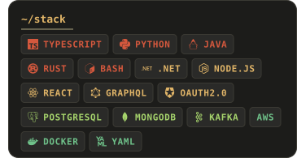

<!--
  Every row is 860px wide at full size (images/header.svg's width), so widths are set as percentages of that.
  Gaps are baked into the SVGs, so keep each row's tags on one line with no whitespace between them.
-->

  

